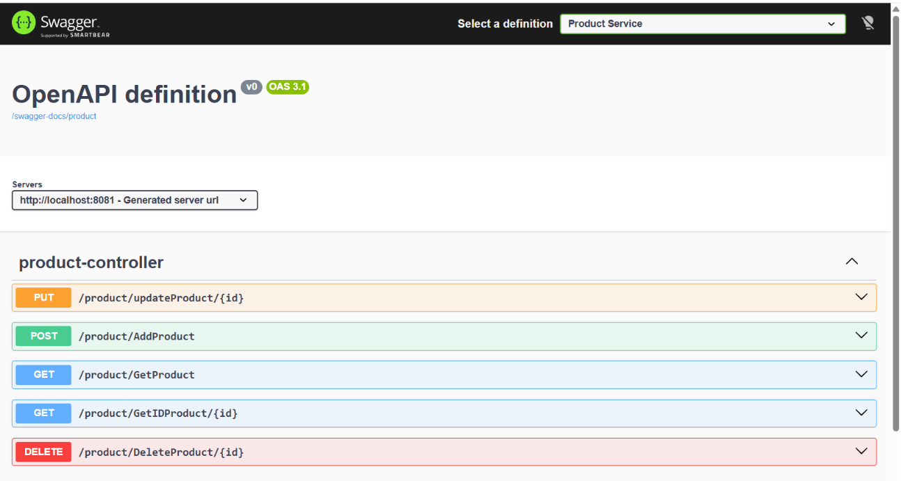
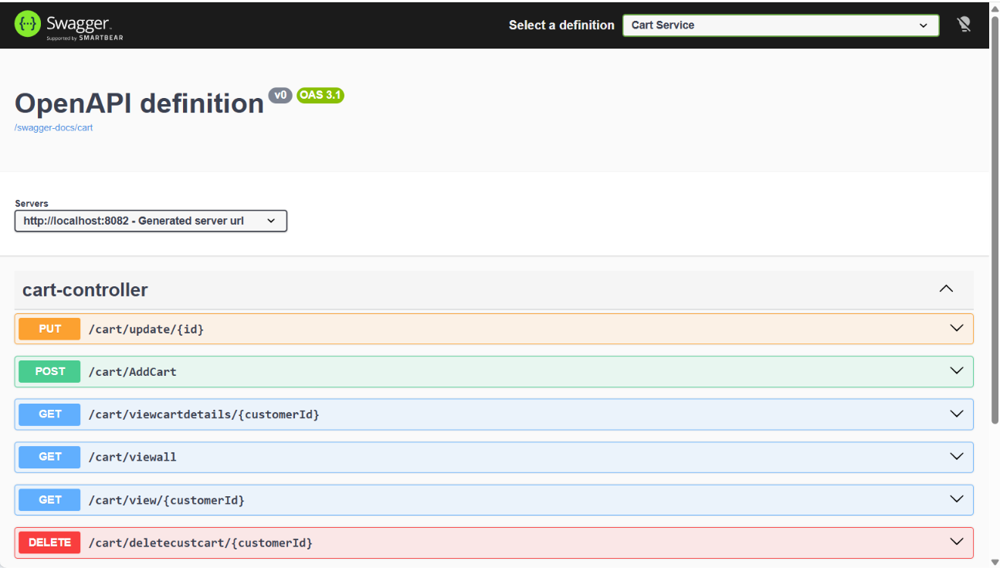
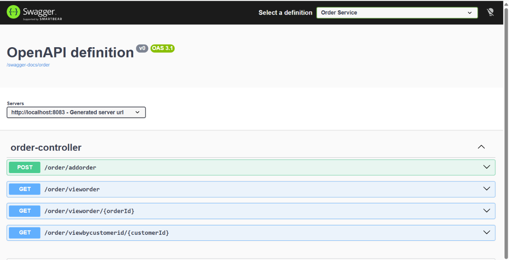
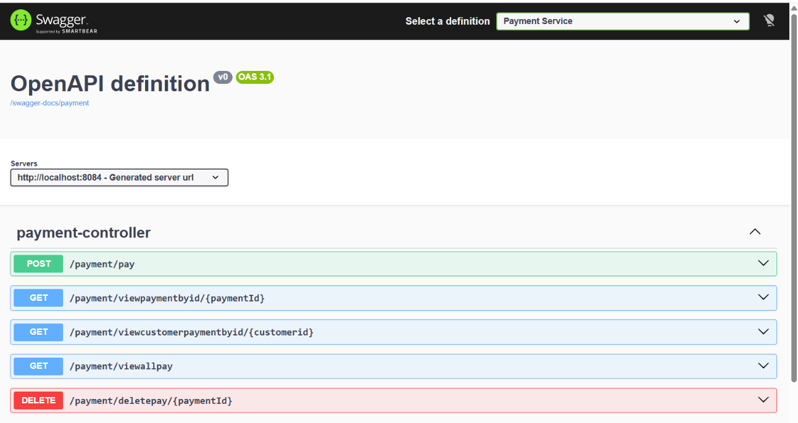

<!DOCTYPE html>
<html lang="en">
<head>
<meta charset="UTF-8">
<meta name="viewport" content="width=device-width, initial-scale=1.0">

</head>
<body>

<h1>🛒 Shopping Cart Microservices</h1>

<strong>A Java Spring Boot E-Commerce Backend Application</strong>

<h2>1. Project Overview</h2>

Shopping Cart is an e-commerce backend application developed using Java,
Spring Boot and Microservices Architecture.

The application allows customers to view products, add products to their
shopping cart, place orders and manage payment records.
Each business functionality is handled by an independent microservice.

<h2>2. System Architecture</h2>

<pre>
                 CLIENT / FRONTEND
                         |
                    API GATEWAY
                      :8080
                         |
       +-----------------+-----------------+
       |         |       |       |         |
    PRODUCT    CART    ORDER  PAYMENT     AUTH
     :8081    :8082   :8083   :8084     :8085
                 |       |
                 +-------+
              REST API COMMUNICATION
</pre>

<h2>3. Technologies Used</h2>

<ul>
<li>Java</li>
<li>Spring Boot</li>
<li>Spring Data JPA</li>
<li>Spring Security</li>
<li>Spring Cloud Gateway</li>
<li>REST APIs</li>
<li>MySQL</li>
<li>Maven</li>
<li>JWT Authentication</li>
<li>Swagger / OpenAPI</li>
<li>Git and GitHub</li>
</ul>

<h2>4. Microservices Description</h2>

<h3>4.1 API Gateway – Port 8080</h3>

Acts as the single entry point for client requests and routes requests
to the appropriate microservice.

<ul>
<li>Request routing</li>
<li>Centralized entry point</li>
<li>Integration with security flow</li>
</ul>

<h3>4.2 Auth Service – Port 8085</h3>

Manages user authentication and authorization.

<ul>
<li>User registration</li>
<li>User login</li>
<li>JWT token generation and validation</li>
<li>Role-based authorization</li>
</ul>

<h3>4.3 Product Service – Port 8081</h3>

Manages product information.

<ul>
<li>Add products</li>
<li>View all products</li>
<li>View product by ID</li>
<li>Update product information</li>
<li>Manage price, category and stock</li>
</ul>

<h3>4.4 Cart Service – Port 8082</h3>

Manages customer shopping carts and communicates with Product Service
to retrieve product details.

<ul>
<li>Add products to cart</li>
<li>View cart items</li>
<li>Retrieve cart details</li>
<li>Validate quantity</li>
<li>Check product stock</li>
<li>Calculate subtotal</li>
</ul>

<h3>4.5 Order Service – Port 8083</h3>

Manages customer orders and communicates with Cart Service to retrieve
cart information.

<ul>
<li>Create orders</li>
<li>View order details</li>
<li>Calculate total order amount</li>
<li>Maintain order information</li>
</ul>

<h3>4.6 Payment Service – Port 8084</h3>

Manages payment-related records.

<ul>
<li>Maintain payment information</li>
<li>Manage payment status</li>
<li>Store order and payment references</li>
</ul>

<h2>5. Service Port Details</h2>

<table border="1" cellpadding="10">
<tr>
<th>Service</th>
<th>Port</th>
<th>Responsibility</th>
</tr>
<tr><td>API Gateway</td><td>8080</td><td>Request routing</td></tr>
<tr><td>Product</td><td>8081</td><td>Product management</td></tr>
<tr><td>Cart</td><td>8082</td><td>Cart management</td></tr>
<tr><td>Order</td><td>8083</td><td>Order management</td></tr>
<tr><td>Payment</td><td>8084</td><td>Payment records</td></tr>
<tr><td>Auth</td><td>8085</td><td>Authentication</td></tr>
</table>

<h2>6. Swagger API Documentation</h2>

<h3>Product Service</h3>

<h3>Cart Service</h3>

<h3>Order Service</h3>

<h3>Payment Service</h3>

<h3>Auth Service</h3>

<h2>7. Key Features</h2>
<ul>
<li>Microservices architecture</li>
<li>Product management</li>
<li>Shopping cart management</li>
<li>Order management</li>
<li>Payment record management</li>
<li>JWT authentication</li>
<li>Role-based authorization</li>
<li>REST API communication</li>
<li>Exception handling</li>
</ul>

<h2>8. Running the Project</h2>
<ol>
<li>Clone the GitHub repository.</li>
<li>Import the services into Eclipse.</li>
<li>Configure MySQL database connections.</li>
<li>Update application properties.</li>
<li>Start the microservices.</li>
<li>Start API Gateway.</li>
<li>Test the APIs using Swagger.</li>
</ol>

<h2>9. GitHub Repository</h2>

</a>

        Developed as a Java Spring Boot Microservices project.
    

    

        GitHub Repository:
        <a href="https://github.com/vumamaheswari1126/Shopping-Cart-MicroServices">
            Shopping Cart Microservices
        </a>
    

</body>
</html>
